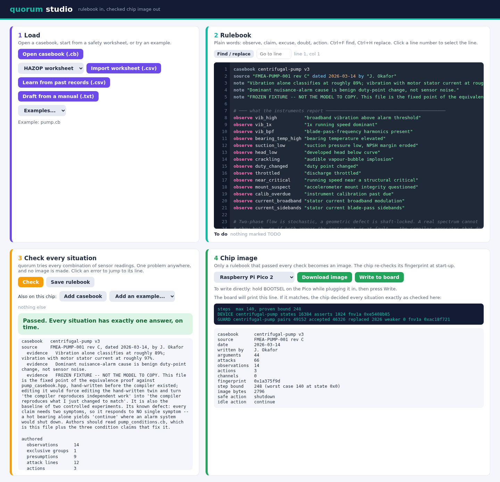
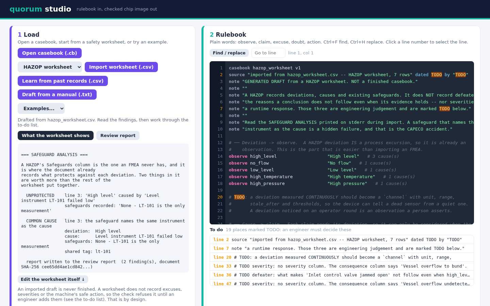

<div align="center">


<h1></h1>

### Rules for machines, written in plain words, checked against every situation, run on an $11 chip

**A tiny, honest judge for machines.** quorum reads a machine's sensors, weighs the evidence the way a courtroom does,
and gives one clear answer with its reasons. Before it is allowed near a machine, every possible combination of
readings has been tried and every answer proven to arrive on time.

**Under 3 KB of flash and 4 KB of RAM** for the whole safety function, with a proven worst-case time, on a Raspberry Pi
Pico 2 or an Arduino Uno R4.

[](LICENSE.md) [](#building) [](studio/README.md) [](#boards) [](#independent-verification)

### See what it does

<a href="docs/quorum.pdf"></a>&nbsp;&nbsp;&nbsp;<a href="docs/quorum.pptx"></a>&nbsp;&nbsp;&nbsp;<a href="casebook/LANGUAGE.md"></a>

<a href="https://github.com/BioDream-LLC/quorum/releases/latest/download/quorum-studio-windows-setup.exe"></a>&nbsp;&nbsp;&nbsp;<a href="https://github.com/BioDream-LLC/quorum/releases/latest/download/quorum-studio-linux-amd64.tar.gz"></a>&nbsp;&nbsp;&nbsp;<a href="https://github.com/BioDream-LLC/quorum/releases/latest/download/quorum-studio-macos.zip"></a>

<sub>The overview is 34 slides in plain words: what quorum is, what it is for, and what it has not done yet.</sub>

**Website: [quorumlogic.io](https://quorumlogic.io)**, with guides to writing and checking rulebooks.

[**What is quorum?**](#what-is-quorum) · [**Everything it does**](#everything-it-does) ·
[**What it looks like**](#what-it-looks-like) · [**Quick start**](#quick-start) · [**How it is tested**](#how-it-is-tested) ·
[**Measured on real chips**](#measured-on-a-real-part) · [**Honest limits**](#honest-limits) · [**FAQ**](#faq)

</div>

---

## What is quorum?

**quorum is a reasoning engine and toolchain for the decisions small machines make on their own:** stop the pump or
let it run, stop the transfer, call a person. Plants are full of alarms that say something is wrong and never say why,
and a dead sensor reads exactly like a healthy one. quorum is built for both problems.

**An engineer writes the rules in plain words.** A rulebook (a `.cb` casebook file) lists what the instruments report,
the conclusions those readings support, the excuses and doubts that can knock a conclusion down, and the actions to
take. Every rule carries the document it came from. Or start from paperwork the plant already has: quorum imports
**HAZOP, LOPA and FMEA worksheets**, and can **draft a rulebook from past records** or **from an equipment manual with
an AI model**, for a person to review and approve.

**Then `cbc`, the rulebook compiler, tries every situation that could ever happen.** All of them, not a sample: every
combination of readings is solved, and a rulebook that gives two answers at once, no answer, an answer too slowly, or
has an action it can never choose, is refused with the exact situation that breaks it. A rulebook that passes becomes
a small file that a Raspberry Pi Pico 2 or an Arduino Uno R4 loads, re-checking its fingerprint at start-up.

**On the chip, every answer comes with its reasons**, including the readings it merely assumed were absent, which is
the distinction that matters when a sensor is dead. The engine uses no heap, no recursion and no floating point, and has
a proven bound on its worst case.

**quorum studio** puts all of it in one desktop app for Windows, macOS and Linux: open or draft a rulebook, check every
situation, and write the chip image, without installing a compiler. It runs entirely on your computer.

## Everything it does

Twelve areas. Where something is partial or unproven it says so, and [`docs/SAFETY_CASE.md`](docs/SAFETY_CASE.md) lists
every claim with the test that establishes it and what that test does not cover.

<table width="100%">
<tr>
<td width="50%" valign="top">
<br>
<b>Plain words, no programming</b>
<ul>
<li><code>observe</code>, <code>claim</code>, <code>excuse</code>, <code>doubt</code>, <code>action</code>: a handful of keywords an engineer can read and sign</li>
<li>The three ways an argument is attacked: its <b>premise</b>, its <b>conclusion</b>, or the <b>step</b> between them</li>
<li><b>Severity</b> breaks ties between conflicting conclusions, the way a reliability engineer already ranks them</li>
<li><b>Sensor channels</b> with ranges, staleness and flatline detection, and hold times ("hot for 5 seconds")</li>
<li><b>Timed readings</b>: "pressure high within 10 s after a start", "hot at any time in the last 5 minutes", "tripped 3 times in an hour", "the first 30 s of a start", "open for 2 s", still checked in every combination</li>
<li>Every rulebook carries its source document, revision and author through to the chip</li>
</ul>
</td>
<td width="50%" valign="top">
<br>
<b>Every situation checked before it runs</b>
<ul>
<li>Every combination of readings is solved: <b>16,384 for the pump rulebook</b>, all of them</li>
<li>Refused: two actions at once, no action at all, an action that can never be chosen, a case over the time bound</li>
<li>Each refusal names the situation and the rules involved, so the author fixes the rulebook rather than guesses</li>
<li>Reports which conclusions hold by default, because those reverse the burden of proof</li>
<li>Warns when a rulebook cannot tell a dead sensor from a quiet one</li>
</ul>
</td>
</tr>
<tr>
<td width="50%" valign="top">
<br>
<b>Small, bounded, and refuses a bad file</b>
<ul>
<li><b>Under 3 KB of flash and 4 KB of RAM</b>, stack included; no heap, no exceptions, no recursion, no floating point</li>
<li>A <b>static worst-case bound</b> from the Cortex-M33 binary, then measured on silicon, and the bound holds</li>
<li><b>One firmware, any rulebook</b>: the chip loads a checked rulebook image instead of being recompiled</li>
<li>The image is checked three ways at start-up: transport, structure and <b>fingerprint</b>; a tampered setpoint is refused</li>
<li>Up to four rulebooks share one chip, proven not to change each other's answers</li>
</ul>
</td>
<td width="50%" valign="top">
<br>
<b>Every decision with its reasons</b>
<ul>
<li>One of <b>five outcomes</b>, never a vague "unknown": decided, ambiguous, rejected, conflicted, faulted</li>
<li>A readable account: what the decision relied on, what it ruled out, and <b>what it assumed was absent</b></li>
<li>A declared <b>safe action</b> per rulebook: a pump stops, a tank transfer stops, a drone does something else</li>
<li>The chip prints a line the host predicted; if it matches, the chip decided every situation as checked</li>
</ul>
</td>
</tr>
<tr>
<td width="50%" valign="top">
<br>
<b>HAZOP, LOPA and FMEA in, gaps out</b>
<ul>
<li>Imports the safety worksheets a plant already keeps and drafts a rulebook from them</li>
<li>Finds <b>"independent" protections that are not</b>: a safeguard sharing an instrument with the cause it guards</li>
<li>Audits a LOPA against <b>its own stated arithmetic</b>, and says when a finding comes from transcription instead</li>
<li>Refuses what a worksheet cannot support, such as FMEA detectability scores used as if they were instruments</li>
</ul>
</td>
<td width="50%" valign="top">
<br>
<b>Draft rules from past records, with care</b>
<ul>
<li>Learns a reviewable rulebook from labelled records (AA-CBR), optionally starting from rules a person wrote</li>
<li>Flags <b>columns filled in after the event</b>, which make a model look accurate and be useless</li>
<li>A single mislabelled record cannot overturn a reviewed rule</li>
<li><b>Honestly:</b> learning raised accuracy on average in four pre-registered tests, but never cleared the bar set in advance</li>
</ul>
</td>
</tr>
<tr>
<td width="50%" valign="top">
<br>
<b>An AI drafts; a person approves</b>
<ul>
<li>Drafts a rulebook from an equipment manual, with a model on your computer (Ollama) or a hosted one (OpenRouter)</li>
<li>Every rule it keeps must <b>quote the manual word for word</b>; mistakes and failed checks are sent back to it</li>
<li>A review lists first everything that could stop the safe action</li>
<li>On four regulations it had never seen, scored against a key written before any run: 86% of checks, five runs each (<a href="casebook/fixtures/manual/eval/RESULTS.md">results</a>)</li>
<li>The draft is marked <b>unapproved</b>, and no chip image can be built until a named person approves it</li>
<li>Hosted models are asked only for providers that keep no copy of the manual</li>
</ul>
</td>
<td width="50%" valign="top">
<br>
<b>One desktop app, nothing to install beside it</b>
<ul>
<li>Open, import, learn or draft a rulebook; edit it with highlighting, find and replace, and a to-do list</li>
<li>Edit the worksheet itself, with undo, and re-import</li>
<li>Check every situation, then <b>download the chip image or write it straight to the board</b></li>
<li>Print a <b>commissioning sheet</b> for the loop check on the real machine, and test a board against it over Modbus</li>
<li>If a rulebook is refused because nothing can argue with it, one click adds a failed-sensor check per reading, each marked for an engineer to confirm</li>
<li>Windows installer with no administrator rights; Linux binary; macOS app for Apple Silicon and Intel; listens on this computer only, with a per-launch token</li>
</ul>
</td>
</tr>
<tr>
<td width="50%" valign="top">
<br>
<b>A safety net for other controllers</b>
<ul>
<li><b>AI guard</b>: another system proposes an action; quorum lets it through only if it is at least as cautious as the rulebook's own answer</li>
<li>Checked for every suggestion in every situation, and reproduced on both chips</li>
<li><b>Modbus RTU</b>: a PLC writes readings into quorum's registers and reads back the decision and the reason</li>
<li>Modbus has no password, so it belongs on a closed, trusted network, and the documentation says so</li>
</ul>
</td>
<td width="50%" valign="top">
<br>
<b>Proof you can check yourself</b>
<ul>
<li>A <b>certificate</b> for every situation: what quorum decided and why, tied to the rulebook by its fingerprint</li>
<li>A separate small checker re-verifies the certificate without trusting quorum's own compiler</li>
<li>The whole labelling rebuilt by <b>CaDiCaL</b>, an independent SAT solver: every argument, every state, no mismatches</li>
<li>Mutation tests prove the checks can fail; a check that cannot fail is not a check</li>
</ul>
</td>
</tr>
<tr>
<td width="50%" valign="top">
<br>
<b>Real chips from three makers</b>
<ul>
<li><b>Raspberry Pi Pico 2</b> (RP2350, Cortex-M33) and <b>Arduino Uno R4</b> (RA4M1, Cortex-M4): same answers as the PC in every situation</li>
<li><b>Raspberry Pi 5</b> runs the full test suite natively, and the second, advisory tier</li>
<li>Compiles for six Cortex-M boards under the same warnings-as-errors set as the host</li>
</ul>
</td>
<td width="50%" valign="top">
<br>
<b>What it is not</b>
<ul>
<li><b>Not certified</b> for safety-critical use, and not yet deployed on a working machine</li>
<li>It does not predict the future; it applies rules a person wrote and approved to what it sees now</li>
<li>Uses beyond factories are possibilities, not yet proven in the field</li>
<li>The full list is under <a href="#honest-limits">Honest limits</a></li>
</ul>
</td>
</tr>
</table>

## What it looks like

**quorum studio, with an example rulebook checked.** Every situation has exactly one answer on time, so the chip image
is ready, with the line the board will print if it decided every situation the same way.



**A HAZOP worksheet imported.** The draft rulebook is never finished, and says what an engineer must decide. The
worksheet's own safeguards are analysed first: here the only safeguard names the same instrument as the cause.



## Quick start

**With quorum studio.** Download it above and run it; a browser page opens on this computer. Pick **Examples... →
pump.cb**, press **Check**, then **Download image** (or **Write to board** with a Pico 2 held in BOOTSEL mode).
[`studio/README.md`](studio/README.md) covers worksheets, learning and drafting from a manual.

**From source** (Linux, CMake and a C++17 compiler):

```sh
cmake -S . -B build -DCMAKE_BUILD_TYPE=Release && cmake --build build -j && ctest --test-dir build
./build/casebook/compiler/cbc casebook/pump/pump.cb      # check every situation of the pump rulebook
```

Then read [`casebook/AUTHORING.md`](casebook/AUTHORING.md) to write your own, and
[`firmware/pico2/RUNNING_ON_HARDWARE.md`](firmware/pico2/RUNNING_ON_HARDWARE.md) to put it on a board.

## How it is tested

- **Every situation, every time.** `cbc` solves the whole input space of every rulebook on every build; CI runs 15
  gates, from the unit suites to the board firmware.
- **Against an independent solver.** CaDiCaL, which shares no code with quorum, rebuilds every label of every argument
  in every state of four rulebooks. See [Independent verification](#independent-verification).
- **On real chips.** The Pico 2 and the Uno R4 decide every situation and print the line the host predicted; damaged,
  re-ordered and tampered images are refused on the board.
- **The documents are checked too.** The numbers in this README are generated from the tools or registered with the
  command that reproduces them, and the safety case is checked against the test suite in both directions.

---

The rest of this page is the engineering in detail: how quorum reasons, what was measured, and what is not claimed.

## Why this rather than a model

The failure mode this product targets is well documented and is not accuracy. It is that predictive-maintenance and
alarm systems generate so many unactionable alerts that operators stop reading them — ISA-18.2 work puts nuisance
rates above 80% in surveyed plants, and false-positive rates of 40–90% have been reported for predictive maintenance
in power generation. A system that is right more often but still cannot say *why* does not fix that.

quorum's outputs are auditable by construction. Every conclusion is a path through declared attack relationships, so
"why did you stop the pump" has a finite, printable answer that names the readings it relied on — **and names the
readings it merely assumed were absent**, which is the distinction that matters when a sensor is dead.

## Measured, on a real part

`arm-none-eabi-g++ 12.2.1`, `-mcpu=cortex-m33 -mthumb -Os`, `-nostdlib`, linked against an RP2350 memory map
(Raspberry Pi Pico 2: 520 KB SRAM, 4 MB flash). Reproduce with `tools/footprint.sh`.

<!-- BEGIN GENERATED footprint -- tools/figures.sh; do not edit by hand -->
| configuration | flash | RAM | stack | total RAM |
|---|---|---|---|---|
| engine only (framework + grounded) | 624 | 1,648 | 2,048 | 3,696 |
| + arbiter + tank casebook | 1,732 | 1,728 | 2,048 | 3,776 |
| + binding layer | 2,864 | 1,848 | 2,048 | 3,896 |
| + witness (on demand) | 4,868 | 3,176 | 2,048 | 5,224 |
| + second casebook (palette) | 6,516 | 4,944 | 2,048 | 6,992 |

The certifiable safety function is **2,864 bytes of flash and 3,896 bytes of RAM including a 2,048-byte stack**, or
1,848 bytes of RAM excluding it.
<!-- END GENERATED footprint -->

Also verified in the linked image: **0 undefined symbols** (the only library functions are `memset`/`memcpy`, both
defined in `firmware/startup.cpp`), **0 floating-point instructions**, and a **worst-case stack of 332 bytes** — the
sum of every frame in the image, which is an absolute ceiling rather than a sample because there is no recursion
anywhere.

### Worst-case execution time: a bound, and a measurement on real silicon

A static bound, derived from the Cortex-M33 binary by implicit path enumeration — per-loop instruction costs counted
from the disassembly, iteration counts derived in closed form from the algorithm rather than estimated:

<!-- BEGIN GENERATED wcet -- tools/figures.sh; do not edit by hand -->
| casebook | instructions | us @ 150 MHz, 2 CPI |
|---|---|---|
| pump | **2,571** | 34.3 |
| tank-409 | 2,412 | 32.2 |
| piper-permit | 1,530 | 20.4 |
<!-- END GENERATED wcet -->

This is a *bound*, which is the stronger of the two kinds of number: it holds for every state, including those no test
would think to run. A measured maximum over 2000 runs is not a WCET — it is the largest value on the paths that
happened to execute. The board's job is to come in *under* this figure; if it comes in over, the model is wrong.

What the model does not cover is the memory system — a part executing from flash through wait states pays more for an
instruction than the count suggests. That is the gap hardware closes.

#### Measured: Raspberry Pi Pico 2, RP2350, Cortex-M33 at 150 MHz — the core and clock the bound was derived for

Three runs on 2026-09-28/29, DWT CYCCNT, 2000 runs per figure, worst-case state:

| | fastest | slowest, across three runs | |
|---|---|---|---|
| `solve` | 2,809 cycles, every run | **3,719 cycles** | 24.8 us — bound says 34.3 |
| pump full decide cycle, warm cache | 10,975 | 15,223 | 101.5 us |
| pump full decide cycle, **cold cache** (sweep) | | **21,746** | 145.0 us |
| tank full cycle with binding layer | 10,401 | 21,130 | 140.9 us |
| steps taken on device | **140** | | `cbc` predicted 140 — **match** |

**The bound holds on its own core.** The slowest `solve` in three runs is 3,719 cycles against the 2,571-instruction
bound: **1.45 cycles per instruction** (3,719 / 2,571), under the 2 CPI the table above converts at. Measured 24.8 us against a
predicted 34.3 us.

**The hardware agrees with the compiler about *which* state is worst**, not only how long it takes. The firmware times
all 16,384 states with a cold cache and keeps the slowest; that search, run on silicon with no cost model, landed on
the same state `cbc` computed on the host as `kWorstCaseMask`. And the device did exactly the 140 steps predicted.

**The memory system is real, and it is the reason the bound matters.** RP2350 fetches code from external QSPI flash
through a cache. On it, the fastest run of `solve` was 2,809 or 2,810 cycles on every one of three runs — the algorithm
is deterministic — while the slowest moved from 3,466 to 3,719 to 3,681. That spread is cache state, not work. The same
measurement on the Uno R4, which executes from internal flash with no cache, returned min = mean = max exactly. A cold
cache costs a further 1.4–1.6x on the full cycle.

The consequence is worth stating plainly: **on a cached part a measured maximum is not a stable number**, and three
runs gave three different ones. That is the general argument for a static bound made concrete on the part in question.
The bound is the figure to budget; measurements show it is not optimistic.

#### Measured: Arduino Uno R4 Minima, Renesas RA4M1, Cortex-M4 at 48 MHz

| | measured | |
|---|---|---|
| `solve` worst-case state | **3,608 cycles** | 75.2 us |
| full decide cycle (instantiate + solve + arbiter) | **13,646 cycles** | 284.3 us |
| binding sample + mask, 4 channels | 1,534 cycles | 32.0 us |
| steps taken on device | **140** | `cbc` predicted 140 — **match** |

`solve` at 1.40 cycles per instruction, identical on two separate flashes, with no variance at all. The instruction
bound transfers to this core: the same source compiled for Cortex-M33 and Cortex-M4 produces an identical instruction
count and an identical opcode mix, differing only in scheduling (`tools/wcet-disassemble.sh cortex-m4`).

#### Read the margin carefully

The 34.3 us in the static table is `solve` alone. Against a 1 ms control cycle that is a 29x margin, and quoting it
without its scope is misleading:

| | margin on a 1 ms cycle |
|---|---|
| `solve` bound, 150 MHz Cortex-M33 | 29x |
| `solve` measured, 150 MHz Cortex-M33 | 40x |
| **worst full cycle measured, 150 MHz Cortex-M33** (cold cache) | **6.9x** |
| **full decide cycle measured, 48 MHz Cortex-M4** | **3.5x** |

The bold rows are what an integrator budgets. None of this contradicts the bound, which covers `solve` and holds on
both cores. But a safety figure that needs three qualifications to be true is one worth printing with all three.

#### What the boards found that no test had

Two identifier collisions with vendor macros, invisible until the code met a real BSP:

- an enumerator named `SysTick`, which CMSIS defines as `#define SysTick ((SysTick_Type *) SysTick_BASE)`
- a function named `bit()`, which the Arduino core defines as `#define bit(b) (1UL << (b))`

In both cases the preprocessor rewrote quorum's own declarations and GCC reported the error inside the vendor header,
far from the cause. The portability gate did not catch either, because it compiled against a **stub** `Arduino.h`
containing none of the vendor macros. The stub now defines them deliberately, and renaming `obs_bit` back to `bit`
reproduces the real toolchain's error. Now `Source::Systick` and `obs_bit()`, with the reason recorded at both
definitions.

The Arduino build also never puts the sketch folder on the include path, so a header that includes another header
cannot resolve it from a sketch at all; the headers stage as a **library**, whose `src/` is on the path.

And three reporting errors of the same shape in the firmware itself — every one of which made correct work look wrong
or safe work look safer. Both boards' firmware divided a **full cycle** by a **solve-only** bound, reporting 5.30 and
8.15 cycles per instruction against a bound that in fact holds; the fix landed in the Arduino sketch and not the Pico
one, because the logic is duplicated. And the Pico's headroom lines were computed from the *warm pump* cycle while the
same printout showed slower figures for the tank and for a cold cache, overstating the margin by half. Each report now
names the scope of both sides at the point of comparison.

Doing the static analysis earlier had already found two more: the state `cbc` nominated for timing was the **wrong**
state — `steps_` weights five loops equally and does not count the seeding loop — so the true instruction-worst state
costs 1.5% more, and the firmware now sweeps all 16,384 states and keeps the worst. And `steps_` was being reloaded
from memory every iteration; accumulating it in a local cut worst-case execution by **9.8%** and flash by 32 bytes.
Neither was visible on x86-64.

Reproduce: [`firmware/pico2/`](firmware/pico2/RUNNING_ON_HARDWARE.md) builds in the `quorum-pico:1` image and flashes
by copying a `.uf2`; [`firmware/arduino/`](firmware/arduino/RUNNING_ON_HARDWARE.md) stages a sketch and library for
the Uno R4. Raw serial captures from these runs are kept beside each, as `measured-2026-09-29.txt`.

For the pump casebook the worst case is the state where **nothing is asserted**: every closed-world edge is live, so
the framework carries its maximum attacks. That is also a healthy machine's most common state, which means the worst
case is not a rare corner — it is what the device does all day.

## Why grounded semantics only, on device

A certification requirement, not a memory compromise. Search-based semantics — stable, preferred, semi-stable — are
NP-hard with no worst-case execution time, so they cannot be a safety function at any SIL. Grounded is polynomial with
a proven step bound.

There is a second reason that costs nothing: the grounded extension is contained in every complete extension, so a
device verdict can never *contradict* a richer semantics computed elsewhere. It can only be less committal. That makes
the split clean — **the microcontroller is the safety function, a Pi is advisory.**

## What is claimed, and what is not

[`docs/SAFETY_CASE.md`](docs/SAFETY_CASE.md) lists every claim this product makes, the test that establishes it, and what
that test does **not** cover — 50 claims, 41 with a ctest. It is generated from `docs/claims.tsv` and checked in CI **in
both directions**: a claim naming a test that does not exist fails the build, and so does a test no claim references.

The second direction is the one that finds things. It is easy to write down the claims you remember; it is hard to notice
the guarantee you verify and never state. On its first run it surfaced five unclaimed tests, one of which turned out to be
the most important capability in the repository — see below.

Two claims are recorded as **unproven**, and they are the two to press hardest on: measured timing on silicon
(`WCET-3`), and whether anyone outside BioDream can write a casebook (`GEN-1`).

### Independent verification

Most tests in this project compare quorum's code against other code written for it. `test_grounded` validates the solver
against a reference implementation written alongside it, so agreement proves *consistency*, not correctness.

**That has now been broken, exhaustively.** `tools/cross-verify-exhaustive.sh` rebuilds quorum's entire labelling using
**CaDiCaL** — Armin Biere's solver, which shares no code with quorum — and compares it argument by argument.

It rests on one identity: **the grounded extension is the intersection of all complete extensions.** (It is complete, so
the intersection is contained in it; it is the *least* complete extension, so it is contained in the intersection.) So
CaDiCaL alone can reconstruct the labelling: an argument is `IN` exactly when "a complete extension excluding it" is
unsatisfiable, `OUT` when something in that set attacks it, `UNDECIDED` otherwise.

<!-- BEGIN GENERATED cross-verify -- tools/figures.sh; do not edit by hand -->
| casebook | states | CaDiCaL calls | mismatches |
|---|---|---|---|
| permit | 1,024 | 31,744 | 0 |
| vote | 512 | 26,624 | 0 |
| pump | 16,384 | 720,896 | 0 |
| tank | 32,768 | 1,474,560 | 0 |
| **total** | **50,688** | **2,253,824** | **0** |
<!-- END GENERATED cross-verify -->

Every label, every argument, every state — not a sample. And the check carries a self-test: `--mutate <arg>` corrupts one
label and the run must then fail, because a comparison that cannot fail is not a comparison.

**Two earlier versions of this were weaker than they looked, and both are worth knowing about.**

The first asked a separate SAT-based ICCMA 2025 entrant and got 1,937 agreements. Then reading that source turned up
`Semantics::grounded()` — the *same worklist algorithm*, because quorum was salvaged from that project. An agreement
produced by shared code is one implementation agreeing with itself.

The second tested three implications over a sample of states, and **one of them was mathematically false**: it required a
grounded-undecided argument to belong to some complete extension. A self-attacker is the counterexample, and any argument
in an odd cycle can behave the same way. Sampling had never hit one; running exhaustively produced 96 false alarms on
`continue` and `gate_no_maintain_reason`, which sit on a cycle. A check that is wrong about the semantics cannot be
evidence about an engine's semantics — so it was replaced by the reconstruction above, which is both correct and stronger.

**Both of those check the solver, and neither can check the compiler.** CaDiCaL and `qcert` both start from the
framework cbc built, so a rule that cbc read or lowered wrongly would be checked perfectly. `tools/refcheck.py` starts
from the rulebook text instead. It is a second implementation of the language in about 300 lines of Python, written
from the documentation rather than from cbc's source. It builds no framework; it evaluates the rules directly to a
fixed point. It then compares its decision with cbc's in every state:
- of every rulebook in the repository;
- of random rulebooks: 3,000 across six seeds, about 510,000 states, after the fix.

Six deliberate mistakes in it (severity ignored, an undercut cancelled by severity, `any` read as `all`, doubts reading
trusted values, `prefer` ignored, a vote off by one) must each be noticed, and are (ctest `refcheck`).

**It found a real compiler bug on its first random run.** When a doubt discarded a reading that another doubt reads
raw, such as the consequent of an `implies`, cbc landed the discarding attack on the raw reading itself. The other
doubt then saw the discarded value, against the documented rule. Worse, the answer depended on whether `undermines`
was written inside the doubt's declaration or on its own line. On the reduced case the safe action went unchosen. It is
fixed (2026-10-14), with `casebook/fixtures/consistency/raw_consequent.cb` as the regression fixture. No rulebook on a
board changed: the pump and the tank compile to identical images. Two drafted fixtures gained one internal argument
and decide all 32 of their states as before.

This is still the same developer writing both implementations, from documentation that developer wrote. It makes a
shared misreading less likely; it does not replace outside review, which quorum has not had.

## The two pump casebooks

`pump.cb` is a frozen verification fixture: the fixed point of the equivalence proof against hand-written C++ that
predates the compiler. It keeps a known defect — every claim needs two symptoms, so it answers no single symptom — because
fixing it would require editing the hand-written twin and the proof would then be circular.

**Authors should read `pump_conditions.cb`**, which is the same file plus the three condition claims that fix it. The diff
is the lesson, and it is the reason both files exist.

## Where the categories come from

[`casebook/TAXONOMY.md`](casebook/TAXONOMY.md) maps quorum's constructs onto the established taxonomies rather than onto
invented vocabulary: **ISO 13379-1**'s descriptor / symptom / failure-mode hierarchy and its Failure Mode Symptoms
Analysis, **ISO 14224**'s failure mode / cause / mechanism coding, **RCM**'s consequence categories including hidden
failures, and the **Carneades** distinction between *assumptions* (which hold until questioned) and *exceptions* (whose
negation holds until positively supported).

That last one is the formal name for the rule this project had been arguing on instinct: a casebook must decide on the
*presence of evidence*, not the *absence of objections*. cbc now reports every claim that holds by default, because those
reverse the burden of proof and that should be a decision rather than an accident. All three in the shipped casebooks
(`no_measure`, `work_status_unknown`, `condition_unestablished`) are deliberate.

No source claims completeness, and neither does the document — the argumentation literature explicitly lacks a
completeness method. It is a systematic pass instead of an accumulation of collisions.

## Boards

Verified by compiling a realistic device translation unit — engine, arbiter, binding, cycle counter, two real
casebooks — for each core under the **same warnings-as-errors set as the host build**. A board needing a warning
relaxed is not supported. Reproduce with `tools/board-matrix.sh`.
<!-- BEGIN GENERATED boards -- tools/figures.sh; do not edit by hand -->
| board | core | flash | RAM | status |
|---|---|---|---|---|
| Raspberry Pi Pico 2 (RP2350) | Cortex-M33 | 2,104 | 2,657 | supported |
| Raspberry Pi Pico 1 (RP2040) | Cortex-M0+ | 2,024 | 2,657 | supported |
| Arduino Uno R4 (Renesas RA4M1) | Cortex-M4 | 2,104 | 2,657 | supported |
| Arduino Nano 33 BLE (nRF52840) | Cortex-M4 | 2,104 | 2,657 | supported |
| Arduino Due (SAM3X8E) | Cortex-M3 | 2,104 | 2,657 | supported |
| Arduino Giga R1 / Portenta (STM32H7) | Cortex-M7 | 2,104 | 2,657 | supported |
| Arduino Uno / Nano (ATmega328P) | AVR 8-bit | -- | -- | **not supported** |
<!-- END GENERATED boards -->

**8-bit AVR is not supported and is not a near-term prospect.** Three reasons, in increasing order of how hard they
are to fix. The C++17 requirement is not negotiable — MISRA C++:2023 is defined against ISO/IEC 14882:2017 — and
Debian's `avr-g++` is gcc 5.4, which predates C++17 entirely. An Uno's 2 KB of SRAM cannot hold a 1.6 KB framework
plus a 332-byte stack plus the Arduino core's own buffers. And the word size is the real problem: every `int32_t`
operation on an 8-bit core costs several instructions, so a part that fits would still be an order of magnitude
slower for no benefit over a $5 Cortex-M.

The Linux side (Raspberry Pi 4/5, aarch64) is verified continuously: every test suite runs on both x86-64 and AArch64.

## The two tiers, and an honest correction

The architecture has always been: **grounded semantics on the microcontroller as the safety function, search-based
semantics (preferred, stable) on a Linux box as advisory.** The safety argument is that the grounded extension is
contained in every complete extension, so the device can never *contradict* the advisory tier — only be less committal.

That argument is now machine-checked rather than cited. `advisory/test/test_two_tier.cpp` enumerates every preferred and
stable extension of every state of three casebooks and checks containment:

| | |
|---|---|
| containment checks | **50,432** |
| violations | **0** |
| action contradictions | **0** |
| states with no stable extension | 0 |

So an $11 part and a Pi cannot disagree about a running machine.

**But the advisory tier turns out not to decide anything the device cannot.** Grounded leaves 224 of 50,176 states
open (0.45%), all of them in the pump; tank-409 and piper-permit have **zero** contested states. Of those 224,
preferred semantics agrees on an action in 186 and stays ambiguous in 38.

And the states preferred resolves are **exactly** the states a compile-time severity annotation resolves —
`advisory/test/test_severity_vs_search.cpp` compares them state by state:

```
baseline Indeterminate states            86
resolved by compile-time severity        48
resolved by runtime preferred semantics  48
resolved by BOTH                         48
resolved ONLY by severity                 0
resolved ONLY by advisory                 0
where both spoke: 48 agreed, 0 differed
```

Not a coincidence, and the mechanism is measurable: of the 224 contested states, 138 are ambiguous purely because of a
**symmetric rebuttal** — two claims attacking each other — and both mechanisms target exactly that. Severity breaks the
tie in the compiler; preferred semantics enumerates both sides and finds they imply the same action.

**Consequence: an NP-hard search on a second box buys nothing a reliability engineer cannot get by writing one number
per claim in a text file.** The remaining 38 states are irreducible by either mechanism, and sending those to a human
is the correct behaviour, not a gap.

This narrows what the Linux tier is *for*. Not better decisions — validation and authoring. `cbc`'s exhaustive
validation is the genuinely heavy computation here (33.5 million states for the non-interference proof), along with
casebook development, witness archival, and fleet trending. That is a real workload and a real product tier; it just
is not "richer semantics at runtime".

## Components

| | |
|---|---|
| `solver/` | the engine. Fixed-capacity `Framework`, `Grounded` solver. No heap, no exceptions, no recursion. |
| `arbiter/` | turns a labelling into a decision. Five outcomes, always yields an executable action. |
| `witness/` | reconstructs a derivation on demand and renders it as prose. Flags assumed absences. |
| `binding/` | physical signals to asserted propositions. Integer-only, hysteresis, staleness, flatline detection, timed readings. |
| `casebook/compiler/` | `cbc`, the casebook compiler. Host tool. |
| `casebook/fixtures/` | casebooks the compiler must refuse, for outcomes no correct casebook reaches. |
| `casebook/pump/`, `casebook/tank/`, `casebook/permit/`, `casebook/vote/` | worked casebooks, in four different problem shapes. |
| `bench/` | cycle counting via DWT, falling back to SysTick. Integer-only, unit-tested on a host. |
| `firmware/` | bare-metal harness for footprint and stack measurement. |
| `firmware/pico2/` | Pico SDK project that measures worst-case execution time on real silicon. |
| `firmware/arduino/` | the same measurement for any Cortex-M Arduino. |
| `advisory/` | **host only.** Exact preferred/stable enumeration. May allocate, has no WCET, must never link into firmware. |

## The five outcomes

Deliberately not collapsed into one "unknown", because conflating a broken solver with an ambiguous plant is a safety
defect — it sends an engineer to the wrong problem.

| outcome | meaning | what a plant should do |
|---|---|---|
| `Decided` | exactly one action In | execute it |
| `Indeterminate` | no action In, an action Undecided | the evidence is genuinely ambiguous — escalate to a human |
| `Unsatisfied` | no action In, nothing Undecided | the casebook rejects every action it declared — **fix the FMEA** |
| `Conflicted` | more than one action In | casebook defect, in the dangerous direction |
| `Faulted` | the computation did not complete | surrender to the hardwired interlock |

The safe fallback is **declared per casebook**, never assumed: a pump's safe state is a full shutdown, a tank's is to
stop the transfer, and a drone has no stopped state at all.

## A casebook

Source is a small declarative language. The compiler generates the C++ device header, and all the plumbing —
gates, closed-world reasoning, sensor-health observations, precedence edges — is generated rather than authored.
Measured: 38–42% of the arguments in both real casebooks are generated.

```
casebook tank-409 v2
source "CSB report 2010-02-I-PR" dated 2009-10-23 by "CAPECO, Bayamon PR"

observe gauge_high     "local gauge read by hand: high"
observe xmtr_normal    "level transmitter reports a normal level"
observe inlet_flow     "X1 open, transfer in progress"

channel tank_level "Tank 409 level transmitter, 4-20 mA" unit percent
  range 0 100
  stale_after 10s
  flatline_after 30m epsilon 0.5
  asserts xmtr_normal below 80.0 release 85.0

doubt xmtr_untrusted "a frozen or missing transmitter is not a reading"
  when tank_level_flatline tank_level_unavailable
  undermines xmtr_normal

claim no_measure "no trustworthy independent measurement of the level exists"
xmtr_normal  rebuts no_measure
gauge_high   rebuts no_measure

claim more_level "more input than output" when inlet_flow
claim unmeasured_filling "filling a tank with no independent measurement of its level"
  needs more_level no_measure

action monitor           idle
action continue_transfer when inlet_flow
action stop_transfer     safe when unmeasured_filling no_measure
prefer stop_transfer over continue_transfer over monitor
```

`undermines` / `rebuts` / `undercuts` are the three ASPIC+ attack forms — attack a premise, a conclusion, or an
inference. `needs` is conjunctive; `when any` is disjunctive; `when all` is conjunctive. All range over readings and
over other claims.

A bare `when` with more than one condition is a **compile error**. It has to be, because `when A B` reads as *and* to
any English speaker and would mean *or*. That exact misreading, in the Piper Alpha casebook below, licensed starting a
pump with no certificate that its pressure boundary was closed — which is the decision the casebook was written to
prevent. A safety language cannot have a keyword whose natural reading is its opposite.

## Three problem shapes

Generality is the only thing that makes a palette of casebooks a product rather than a demo, so it is tested against
deliberately dissimilar problems.

| casebook | shape | source |
|---|---|---|
| pump | competing hypotheses — which failure explains the symptoms? | synthetic FMEA, literature-grounded |
| tank | disagreeing sources — can I trust the measurement? | CSB 2010-02-I-PR (CAPECO, 2009) |
| permit | records and authority — did anybody establish what was done? | Cullen Inquiry (Piper Alpha, 1988) |
| vote | redundant instruments — do enough of them agree? | IEC 61511 / ISA-TR84.00.02 2oo3 voted trip |

Four shapes, five casebooks (`pump_conditions` is `pump` plus three condition claims; `gearbox` is the authoring guide's
worked example). The tank casebook forced two language additions. Piper Alpha needed none at all. The voted trip needed
one piece of sugar, `vote k of`, proved equivalent to the hand expansion over every state.

Both accident casebooks reproduce the accident from the recorded information state and take the action that was not
taken. For CAPECO that means detecting a level transmitter delivering fresh, in-range, entirely plausible samples
that have not moved in thirty minutes — a condition staleness checking cannot see, and the one nobody detected. For
Piper Alpha it means refusing to treat "nobody warned us" as "the work had not begun", and routing the decision to
the person who could weigh a production trip against an unverified pressure boundary.

Read those results with the caveat in mind: reproducing an outcome already known is postdiction.

## What the compiler does for you

`cbc` runs six passes and refuses to emit a header that fails any of them.

1. **parse** — line-oriented, no expressions.
2. **resolve** — undefined names, duplicates, and *type* errors: `undermines` must target a reading, `rebuts` must
   target a claim, an action can never be evidence.
3. **lower** — generate gates, closed-world, raw/claim splits, incoherence doubts, precedence, idle wiring.
4. **check** — dead gates; exactly one idle and one safe action; observation count within the 32-bit mask; and
   whether the casebook can actually *notice* a dead sensor.
5. **validate** — solve **every state of the entire input space**. Reports the outcome distribution, the worst-case
   step count against the bound, an ambiguity breakdown separating genuine diagnostic ambiguity from instrument
   incoherence, and how often each action is selected. **Fails** on any state that selects two actions or none, on any
   state that exceeds the step bound, and on any declared action that is never selected. Affordable only because
   solving is nearly free, which is where a competition solver's speed pays for itself.
6. **emit** — device header, ICCMA `.af` and ASPARTIX `apx` interchange, and a generation report.

Several casebooks can be compiled onto one device with `--palette`. The frameworks are unioned; the policies are not,
because a pump action and a tank action being In at the same time is correct behaviour and a merged policy would
report it as `Conflicted`. One solve, N verdicts. The compiler checks that no attack crosses between casebooks and
that each member's subgraph is preserved exactly, which is what makes each member's independent validation carry
over.

Pass 5 is why this is a compiler and not a library. A casebook is not shipped on the strength of the scenarios its
author thought of.

## Learning a casebook from records

`learn/` is a host-only front end to the compiler. It learns a casebook from labelled records with AA-CBR (Cyras,
Satoh & Toni 2016) on quorum's own grounded solver, optionally starting from a reviewed casebook, and writes the
result as ordinary `.cb` source. From there it is the same path as a hand-written casebook: `cbc` validates every
state and proves the bound, and the device runs the header. Nothing learns on the device.

```
records + reviewed rules ──► learn/ ──► .cb source (reviewable) ──► cbc ──► header ──► device
```

What has been checked, by `ctest`:

- the compiled casebook decides **every** input state exactly as the learner does (`learn_casebook_e2e`, and the
  device header itself in `learn_device_header`);
- `cbc` accepts the learned casebooks that contain learned exceptions, and **refuses** the ones that are only rule
  lists, as it refuses a raw FMEA import (`learn_cbc_accepts_defeasible`, `learn_cbc_refuses_rule_lists`);
- a single mislabelled record cannot overturn a reviewed rule (the exception guard, `learn_aacbr`).

Whether learning helps was tested four times, each with its criteria committed before it ran
(`learn/PREREGISTRATION.md`, every outcome pinned byte for byte by a ctest). Adding learning to an incomplete casebook
raised balanced accuracy by **+8 to +20 points on average** every time, and was worse on only 5 of 200 fresh problems.
On AI4I the incomplete casebooks missed 1,131 failures alone and 320 with learning. But **all four tests returned
NOT SHOWN** against the bar set in advance, because learning gains nothing when the missing knowledge is redundant or
cannot be expressed in the observations, and plain 1-NN is at least as accurate as AA-CBR alone (LEARN-A3). The case
for learning in quorum is that it writes reviewable casebooks faster and adds exceptions to reviewed rules; it is not
that it is a better classifier.

## One firmware, any casebook: the runtime and the studio

The header path compiles a casebook INTO the firmware, so every casebook needs a cross-compiler. The runtime path does
not. `cbc --blob` writes the validated casebook as a data image (the pump's is 2,796 bytes); one prebuilt firmware per
board (`firmware/pico2/runtime.cpp`, target `quorum_runtime`) loads it at boot from a fixed flash region
(`runtime/include/quorum/runtime/layout.hpp`). The loader checks transport (CRC-32), structure (every index and capacity)
and identity (the fingerprint, recomputed from the tables it loaded). On anything but success the device prints why and
does not decide. cbc will not write a blob with `--no-validate`.

Equivalence with the header path is tested, not argued: `runtime_blob_*` decides every state of nine reference
casebooks through both paths and requires the same outcome, action and step count (claims RT-1 to RT-9). On a Pico 2 a
studio-made pump image printed the host's DEVICE line exactly, over 16,384 states, with a worst cold solve of 25,727
cycles = 171.513 us. That is about 18% above the compiled-header build of the same casebook: the runtime's framework has a
fixed capacity of 128 arguments, and `reset()` is linear in capacity. Measure the runtime, not the header, if the runtime
is what ships.

The same image, built for an Uno R4 Minima (`firmware/arduino/quorum_runtime`, written by DFU), printed the identical
DEVICE line, with a worst cold solve of 18,240 cycles = 380.000 us at 48 MHz. On that board an image with one flipped
bit was refused as damaged, and an image with two attack targets swapped and its CRC repaired was refused as a
fingerprint mismatch; neither decided anything (`firmware/arduino/measured-runtime-2026-10-01.txt`).

Several casebooks can share one chip: `cbc a.cb b.cb --palette --blob` writes a format-2 image, which the same runtime
loads, solving the combined framework once and applying each casebook's own policy. Swept with the other casebook
quiet, each member prints exactly the DEVICE line it prints alone; an Uno R4 running pump + tank did so for both
(worst cold 31,288 cycles = 651.833 us). A palette has no binding layer, as the palette header has none: it takes
the presence mask directly and cannot tell a dead sensor from a quiet one.

`studio/` is a desktop tool around this (Go, standard library only, built in Docker by `studio/build.sh`). It embeds
cbc, the HAZOP/LOPA/FMEA importers, `qblob` and the runtime firmware, and serves a local page: import a worksheet, edit
the draft and the worksheet, check every state, write the `.uf2`. It listens on 127.0.0.1 only, with a per-launch token.
It does no reasoning of its own; every verdict comes from the same tools the test suite runs.

## Building

```sh
cmake -S . -B build -DCMAKE_BUILD_TYPE=Release && cmake --build build -j && ctest --test-dir build
bash tools/ci.sh              # all 15 gates, the single entry point
./tools/footprint.sh          # Cortex-M33 footprint, needs docker
./tools/figures.sh --update   # after any change that moves a measured number
```

The studio, with both board firmwares and the Windows installer, needs only Docker, git and bash:

```sh
studio/build.sh               # -> studio/dist/: quorum-studio (Linux), quorum-studio.exe, the installer
MAC=user@host studio/build-macos.sh   # after build.sh: the macOS zip, built on a Mac over ssh
```

On a machine that has never built quorum, `build.sh` makes its Docker images from the Dockerfiles here, fetches the
pinned Pico SDK (2.1.1) into `build/`, and generates the headers the firmware needs. Checked 2026-10-14 from a fresh
copy of the public tree, with no images, no SDK and no build folder: about two minutes on top of the Docker downloads.

### The numbers in this file are checked

Four tables above — footprint, the CaDiCaL cross-check, board support, and the WCET bounds — are **generated** from the
tools that produce them, and CI fails if they drift. Every remaining hand-written figure in this README and in
`docs/claims.tsv` is registered in [`docs/figures-allow.txt`](docs/figures-allow.txt) with the command that reproduces it,
checked in both directions so that neither an unaccountable number nor an abandoned one can sit in either document.

This exists because a full test sweep once found every executable check passing and twenty-six documented numbers wrong.
The headline advertised a 2,640-byte safety function that had measured 2,620 since a speedup, all six board flash figures
were stale, and the tank casebook's worst-case bound was **under**-reported at 2,357 instructions when it had risen to
2,412. Everything else here is checked against the thing it describes; the front door was checked by nobody.

`tools/figures-tamper.sh` proves the gate can fail, on four separate drift paths, because a check that cannot fail is
worse than no check.

All targets build under `-Wall -Wextra -Wpedantic -Wconversion -Wsign-conversion -Wshadow -Werror`, including every
generated header — a compiler that emits code it would reject from a human is not finished. Device components are
additionally gated with `-ffreestanding -fno-exceptions -fno-rtti -fno-threadsafe-statics`.

## Honest limits

- **Timing is measured on two cores, and it is a measurement, not a WCET.** On the Cortex-M33 the bound was derived for
  (Pico 2, 150 MHz) and on a Cortex-M4 (Uno R4, 48 MHz), the bound holds and the device takes exactly the 140 steps
  `cbc` predicted. But on the cached RP2350 three runs gave three different maxima, so a measured maximum is evidence
  that the bound is not optimistic, not a guarantee in itself. What is guaranteed is the instruction bound; converting
  it to time still assumes a CPI, now measured at 1.40–1.45 against the 2 assumed. The memory system has not been
  analysed statically at all. Footprint and stack remain measured facts on every core in the board matrix.
- **The measured margin is 3.5x to 6.9x, not 29x.** The 29x figure is `solve` alone. The worst full cycle measured is
  145 us on the Pico 2 with a cold cache, and 284 us on the 48 MHz Uno R4, against a 1 ms budget. All are true, and only
  the full-cycle figures are what an integrator budgets.
- **Both casebooks were written by quorum's own developers**, from documents chosen with outcomes already known. The tank
  result reproduces a real accident, but reproducing a known outcome is postdiction, not prediction. The strongest
  missing evidence is a reliability engineer encoding a casebook from an FMEA quorum's developers have never seen, and the
  exhaustive validator surfacing an ambiguity they did not know their document contained.
- **30 observations per casebook**, because the presence mask is 32-bit, and the full check doubles in time with each
  one. It uses every core and gives byte-identical results however many. Measured on synthetic rulebooks
  (`casebook/fixtures/scale/gen.py`) with an 8-core i9-9900K: 21 readings 0.2 s, 24 readings 1.7 s, 27 readings 14 s,
  30 readings 2 minutes. That is fine at a desk and too slow to repeat on every keystroke. `cbc --symbolic` checks the
  main invariants of all states at once in milliseconds, but the chip image still needs the full check.
- **A learned casebook has run on silicon once per board, not under CI.** On 2026-10-01 the Pico 2 and the Uno R4
  each decided all 1024 states of a learned casebook identically to the learner (same per-state fingerprint as the
  host). The host check runs on every build; the board runs are single captures in `firmware/*/measured-learned-*`.
- **The check proves the rules, not the plant.** Whether each reading comes from the right instrument, each threshold
  is set where the document says, and the controller passes each reading on is not something exhaustive validation
  can see. The studio prints a commissioning sheet for that loop check, and can drive a board through the same sheet
  over Modbus (41 of 41 states on a Pico 2). But only a person working through it on the real machine checks the
  wiring, and no plant has done so yet.
- **Time is limited to five forms, and when they are set is tested, not proved.** A rulebook can say "X within T
  after Y", "X within the last T", "X N times in T", "X within the first T" and "X for T", and chain them. The rules are still
  checked in every combination of readings, but whether the device sets a timed reading at the right moment is shown
  by tests against a second implementation, not by exhaustive validation. A timed reading cannot watch a conclusion,
  and the device sees only what the controller writes, so a pulse on the plant shorter than the controller's scan
  time is missed. On a Pico 2 and an Uno R4, each with its own clock, 8 of 8 timed checks passed, and the Pico waited
  out the 5-minute and 1-hour windows (`firmware/*/measured-timed*-2026-10-26.txt`). The studio's bench test covers
  timed rulebooks on the board's test clock, which stays on until the board is reset.
- **RPN does not translate.** Severity does, through ASPIC+ preference ordering (`severity 1..10` on a claim), but
  occurrence and detection are population statistics with no meaning for the single machine a device is attached to.
- **`exclusive` groups are validated even where a declared binding makes them unreachable.** Conservative on purpose:
  the exclusion holds only if the integrator uses the binding layer.

## Provenance

Every casebook carries the document it came from, its date, and its author through to the generated header and into
the witness. A threshold is not a firmware constant here; it is a line in a reviewed, versioned document. Changing one
changes the document, the version, and the explanation.

## Documentation

| | |
|---|---|
| [**Overview (PDF)**](docs/quorum.pdf) | 34 slides in plain words; also as [PowerPoint](docs/quorum.pptx) |
| [**The rulebook language**](casebook/LANGUAGE.md) | Every keyword, with what the compiler generates from it |
| [**Writing a rulebook**](casebook/AUTHORING.md) | A worked example from an FMEA to a checked rulebook, and the mistakes to avoid |
| [**Where the categories come from**](casebook/TAXONOMY.md) | quorum's constructs mapped onto ISO 13379-1, ISO 14224, RCM and Carneades |
| [**Safety case**](docs/SAFETY_CASE.md) | Every claim, the test that establishes it, and what that test does not cover |
| [**quorum studio**](studio/README.md) | Building, running and using the desktop app, including drafting from a manual |
| [**Guard and Modbus**](runtime/GUARD_AND_MODBUS.md) | Checking another system's suggestions, and the Modbus RTU register map |
| [**Pico 2**](firmware/pico2/RUNNING_ON_HARDWARE.md) · [**Uno R4**](firmware/arduino/RUNNING_ON_HARDWARE.md) | Building, flashing and reading the board's output |

## FAQ

**Is quorum free? What is the licence?**
quorum is source-available under the [**PolyForm Noncommercial License 1.0.0**](LICENSE.md). You may use, study, change
and share it for any noncommercial purpose: personal projects, research, teaching, and use by charities, schools, public
research bodies and government institutions, as that licence defines them. **Commercial use needs a commercial licence
from BioDream LLC**: write to [firstmind@biodream.ai](mailto:firstmind@biodream.ai).

**Is it certified for safety-critical use?**
No. It is designed with certification in mind (bounded time, no heap, no recursion, every claim tied to a test), but it
has not been assessed against IEC 61508 or any other standard, and it has not run a working machine. Until it is, use it
beside your existing protections, not instead of them.

**Is it machine learning?**
No. It is symbolic: it applies rules a person wrote and approved, and every answer is a path through those rules that
can be printed and argued with. It can *draft* rules from records or from a manual, but a draft is only a proposal, and
it must pass the same every-situation check as a hand-written rulebook.

**Does my data go anywhere?**
No. quorum studio runs on your computer and listens only to it. The one exception is drafting from a manual with a
hosted AI model, which sends the manual to that service; the studio asks you to allow it first, and a model on your own
computer sends nothing anywhere.

**Which chips does it run on?**
Measured on a Raspberry Pi Pico 2 and an Arduino Uno R4; compiled and supported for the other Cortex-M boards in the
[Boards](#boards) table. 8-bit AVR boards such as the classic Uno are not supported.

**How do I report a bug?**
[Open an issue](https://github.com/BioDream-LLC/quorum/issues) with the rulebook, the command or the studio step, and
what happened. **Security problems:** please report them privately through this repository's Security tab ("Report a
vulnerability"), not in a public issue.

## Contributions are not accepted

quorum is developed and maintained by BioDream LLC, and it stays that way. **Pull requests will not be reviewed or
merged.** This software decides what machines do, and the discipline that makes it worth trusting is that every claim is
tied to a test that can fail. That standard is easy to state and slow to enforce across contributors.

**Bug reports are wanted.** A clear report of something that does not work is more valuable here than a patch.

The licence still lets you take a copy, change it and share the result for noncommercial purposes: what is closed is the
path back into this repository, not what you may do with your own copy.

## Licence

[PolyForm Noncommercial License 1.0.0](LICENSE.md). Copyright 2026 BioDream LLC. See [NOTICE](NOTICE). Commercial
licences are available from BioDream LLC.

CaDiCaL, used only by the independent cross-check, is Armin Biere's and is fetched and built separately under its own MIT
licence; it is not part of quorum. Raspberry Pi, Arduino and Modbus are trademarks of their owners, used only to describe
what quorum runs on and speaks.

**Keywords**
argumentation engine · abstract argumentation · grounded semantics · ASPIC+ · Dung · explainable AI · symbolic AI ·
rule engine · safety function · functional safety · IEC 61508 · IEC 61511 · SIL · alarm management · ISA-18.2 · alarm
fatigue · condition monitoring · predictive maintenance · fault diagnosis · FMEA · HAZOP · LOPA · RCM · ISO 13379 ·
ISO 14224 · embedded C++ · C++17 · no heap · WCET · worst-case execution time · microcontroller · Cortex-M33 · Cortex-M4 ·
Raspberry Pi Pico 2 · RP2350 · Arduino Uno R4 · Raspberry Pi 5 · Modbus RTU · PLC · AI guardrail · LLM guard · SAT ·
CaDiCaL · model checking · exhaustive verification · source available · PolyForm Noncommercial
